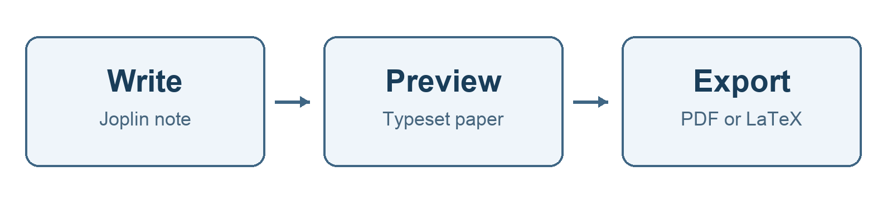

# Abstract

Joplin Scholar brings a typeset paper preview to the place where notes are written. This example is both a short guide and a working manuscript: its title, authors, abstract, contents, equations, citations, footnotes, figure, and table are produced from one Markdown note. It follows a simple route from drafting to PDF or LaTeX and shows how the same source can remain useful as a working note. The authors and affiliations above are fictional and illustrate the title-page format.

[toc]

[lof]

[lot]

# Introduction

Academic writing often moves between a note editor, a reference manager, and a typesetting system. Joplin Scholar connects these steps in Joplin Desktop: write in a note, inspect the typeset preview as the text changes, and export a PDF or a LaTeX source file. Pandoc provides the underlying conversion from Markdown to other document formats [@pandoc], while Joplin supplies the note-taking environment [@joplin].

This document is a demonstration rather than a research study. Its source is intended to be read alongside the PDF: the note reveals the syntax, while the preview shows the result. The diagram in Figure \@ref(fig:workflow) gives an overview of the workflow; Section \@ref(sec:writing) explains the manuscript features.

{#fig:workflow width=80%}

# Writing the manuscript {#sec:writing}

## Title, authors, and abstract

The YAML at the beginning of this note supplies its title and authors. Alice and Benjamin share an affiliation; Alice also has a second affiliation and a corresponding-author email. Open **Document metadata** to edit authors and their affiliations, select corresponding authors, or edit title, subtitle and date. **Full YAML** lets you change any other metadata field. Save to write your changes into the note. The YAML also accepts R Markdown author lists and optional author and affiliation URLs.

The **Abstract** heading above becomes a LaTeX abstract; it ends at the next heading or contents marker. It can include *emphasis*, **strong text**, mathematics, and citations. Use Joplin's Markdown editor for YAML and the specialised examples in this paper.[^editor]

[^editor]: Keep a copy of important Markdown before switching editors, and check the Scholar preview after editing.

## Structure and navigation

Headings organise the paper, and `[toc]` produces the table of contents. The separate `[lof]` and `[lot]` markers create the lists of figures and tables shown above. Scholar also recognises other Joplin contents markers, including `[[toc]]`. These lists are generated by LaTeX and may need more than one compilation when working with an exported `.tex` file.

Scholar rebuilds after edits; adjust the delay in **Settings → Joplin Scholar**, or use **Refresh**. Scroll and select text in the preview. Click a contents entry or a cross-reference number to jump to its target. Use the zoom controls or hold Shift while turning the wheel; without Shift, the wheel scrolls. **Open PDF** opens a snapshot in the default viewer; open it again after editing. **Detach** opens the live preview and controls in a separate browser window; **Return to Joplin** restores the panel.

The **Document style** dropdown changes layout for this note and its exports; YAML layout fields take precedence. **Document options** adds line numbers, moves affiliations to the end, changes line spacing, numbers sections, or switches between A4 and US Letter. Some publisher classes control affiliation placement. Choices include book and report layouts, KOMA-Script, Memoir, ClassicThesis, Tufte, APA 7, Elsevier, IEEE, ACM, REVTeX and Springer Nature. Book layouts turn top-level headings into chapters. Each style needs its corresponding TeX package; Springer Nature's `sn-jnl.cls` can be configured in Scholar settings. IEEE tables occupy full-width pages. Publisher and thesis layouts are starting points; follow the journal's or university's instructions. **Citation style** controls references independently.

## Mathematics and numbered equations

Inline mathematics can be written as $x^2 + y^2 = r^2$ or with TeX delimiters, as in \(a^2 + b^2 = c^2\). A displayed equation may use either double dollar signs or `\[` and `\]`:

\[
\bar{x} = \frac{1}{n}\sum_{i=1}^{n} x_i
\]

For a numbered equation, add a bookdown-style label. Equation \@ref(eq:mean) defines the arithmetic mean of observations \(x_1,\ldots,x_n\):

\begin{equation}
\mu = \frac{1}{n}\sum_{i=1}^{n} x_i (\#eq:mean)
\end{equation}

The reference above updates with the equation number. In the Markdown editor, the label is written as `(\#eq:mean)` in the equation, and the reference is `\@ref(eq:mean)`. A label must be unique, and every equation reference must point to an existing label. Scholar processes this syntax for its preview and exports; it does not execute R code.

## Figures and tables

Figure \@ref(fig:workflow) is a Joplin image attachment. To add your own, attach or paste an image, put it on its own line with blank lines around it, and write its caption in the brackets. Keep Joplin's resource ID and give the figure a unique label:

```text
{#fig:example}
```

Downloaded attachments appear in the PDF and the LaTeX export. The caption is also the default alternative text. To add a cross-reference, place the cursor in the Markdown editor, open **Cite**, choose **Figure**, **Table**, or **Section**, and select an item. Scholar adds a label when needed and inserts a reference; its number updates when items move. You can also write `Figure \@ref(fig:example)` yourself. The section in this example is labelled `{#sec:writing}`. Section references require numbered headings. This example sets `numbersections: true` in YAML; remove that field to control numbering in **Document options**.

For Table \@ref(tab:workflow), write a Pandoc pipe table or insert a table using Joplin's editor, then add a caption and a unique label on a separate line after it. Use `Table \@ref(tab:workflow)` to refer to it. The caption appears in the list of tables.

| Stage | In Joplin | Scholar's contribution |
|:------|:----------|:-----------------------|
| Draft | Write a note in Markdown | Build a typeset preview |
| Cite | Add Pandoc citations | Apply a citation style |
| Review | Revise the note | Refresh the PDF preview |
| Share | Choose an export | Save PDF or LaTeX |

Table: A practical workflow for a paper written in Joplin. {#tab:workflow}

## Footnotes

A footnote can clarify a point without interrupting the main text.[^example] This note uses the GitHub-style `[^label]` syntax. Scholar also accepts Pandoc inline footnotes and its own `{{fn: ...}}` marker; the **Footnote** control can create a marker for copying into the note.{{fn: This footnote was produced by Scholar's own marker syntax.}}

[^example]: Footnotes are useful for brief qualifications, definitions, or supplementary details.

# Citations and references

This manuscript cites Joplin, Pandoc, and Zotero. Its YAML contains reference records and `bibliography: []`, so these citations work without a separate `.bib` file or Zotero connection. Pandoc processes the citations and bibliography [@pandoc].

A citation such as `[@pandoc]` points to a reference; it can include several keys and page locators. To add Zotero sources, install Better BibTeX and keep Zotero open. Place the cursor in the Markdown editor, choose **Cite → From Zotero**, and select a source to insert its citation. Scholar combines those sources with the embedded references. Alternatively, configure a local bibliography file. Add a references heading where the list should appear [@zotero].

Choose a bundled citation style from Scholar's **Citation style** dropdown and watch the citations and references change. You can instead add `csl: apa` (or another built-in style name or an absolute CSL file path) to the YAML metadata; a note's `csl` field takes precedence over the dropdown. Remove that field to use the dropdown again. Available styles include APA, MLA, Chicago, IEEE, and Vancouver. Check the rendered result against the requirements of the intended journal.

# Conclusion

Use **View → Toggle Joplin Scholar** to show or hide the panel, and **View → Change application layout** to move it. Pandoc and a LaTeX engine must be installed locally. Use **Project** to insert a link to another Joplin note and include its content at that position. Use **Export** to save PDF or LaTeX, or choose **Submission ZIP** to package the LaTeX and images for Overleaf. Citations in that ZIP are already rendered; check the result and journal requirements. A custom Pandoc LaTeX template can be configured in Scholar settings. Publisher-specific templates and formatting may still need adjustment.

# References
